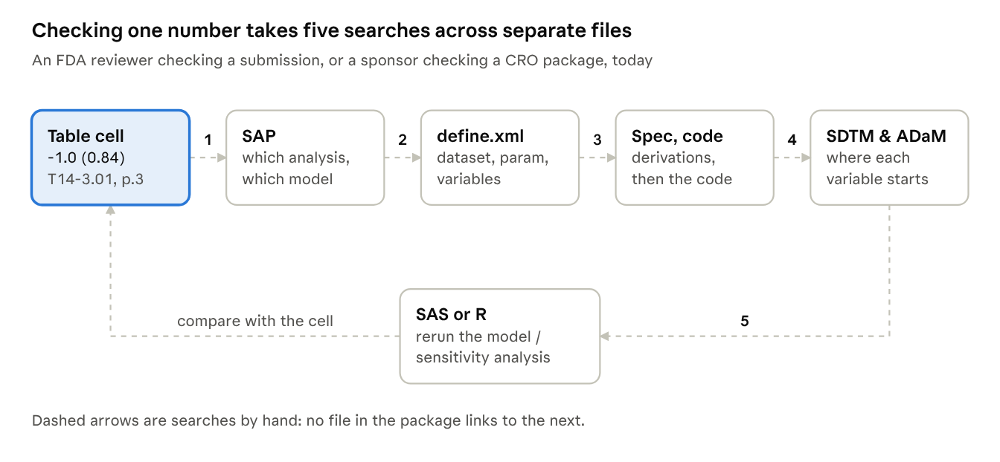
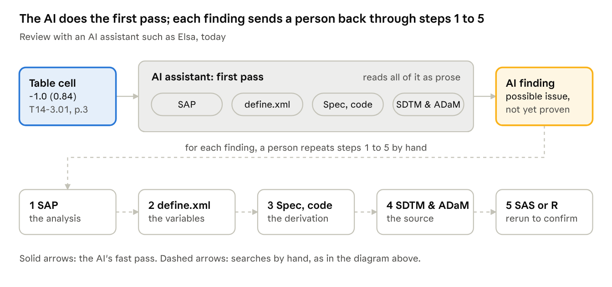
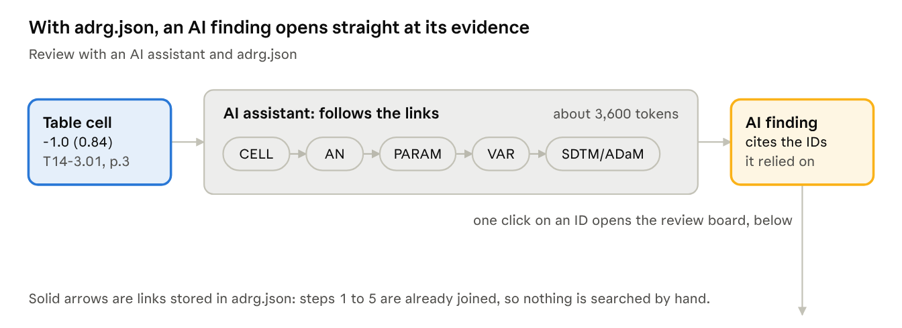
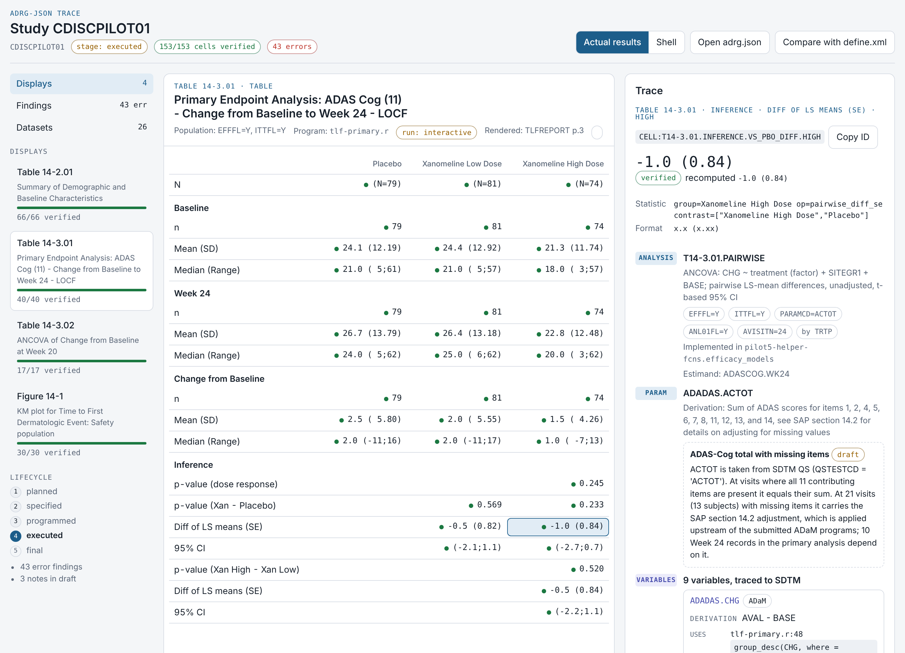
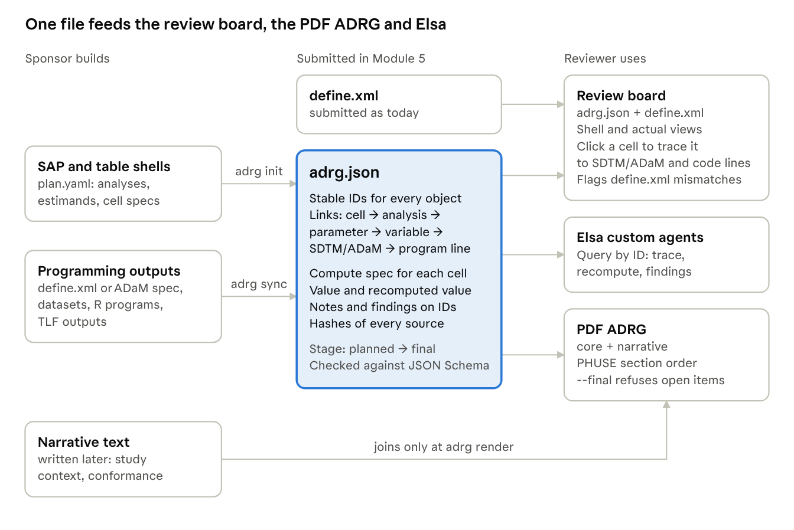

# Proposal: ADRG-JSON, an AI-ready Reviewer's Guide

Ning Leng · November 25, 2026 · draft for discussion

Traditionally, when a reviewer reviews a package, such as an FDA reviewer reviewing a submission or a sponsor reviewing a package delivered by a CRO, they rebuild the lineage of each result by hand from separate documents. AI assistants such as FDA's Elsa read those documents faster, but they still rebuild the same lineage from prose, at a high token cost and with answers that are hard to check. We propose writing the lineage part of the ADRG as a small JSON file, `adrg.json`, and keeping the rest of the ADRG as prose.

On R Consortium Pilot 5, a lineage question then takes about 3,600 tokens instead of about 51,000, and all 153 table cells recompute from the data in seconds.

This is the proposal for **Step 3 of [R Consortium Pilot 7](https://github.com/RConsortium/submissions-pilot7-AI-review#project-design)**, which asks whether a different file format or structure can make FDA AI review more efficient and human oversight more streamlined. The Pilot 5 prototype traces 153 cells, in the primary endpoint table and three other displays, from each displayed value back to the datasets, filters and programs that produce it.

## Reviewing a package today

Reviewers of a submission package rebuild this lineage by hand today:

- **An FDA reviewer reviewing a submission** receives the protocol, SAP, ADRG (PDF), define.xml, datasets, programs, outputs and CSR as separate files in eCTD Module 5.
- **A sponsor reviewing a CRO's package** receives the same kinds of files and must accept them before they go to FDA.

To check one number in a table, the reviewer:

1. Finds the display and its analysis in the SAP.
2. Finds the dataset, parameter and variables in define.xml.
3. Reads each derivation in define.xml or the spec, then in the program code.
4. Follows each variable back to SDTM/ADaM.
5. Reruns the analysis in SAS or R to confirm the number, or modifies the code to test a sensitivity question.



Each step crosses into a different file. No file says which program line produced which cell, so steps 1 to 4 are searches and the links live only in the reviewer's head.

## With an AI assistant, the gaps remain

An AI assistant such as Elsa makes the reading faster, but it rebuilds the same lineage from the same prose.



The assistant reads every file quickly, but its findings carry no link to their evidence, so each one is checked the old way.

- **Token cost.** For any question, the assistant reads all the documents to find the relevant lines: on Pilot 5, 13 files and about 4,800 lines, roughly 51,000 tokens, and the cost grows with the size of the submission.
- **Memory.** Language models recall facts in the middle of long inputs less reliably ([Liu et al.](https://arxiv.org/abs/2307.03172v3)), so more reading means more chances to miss the one line that matters.
- **Mix-ups.** Names repeat across datasets: `AVAL` and `BASE` exist in both ADADAS and ADLBC with different meanings, and a plausible but wrong link reads like a right one.

**Evidence from Pilot 7.** In [Step 1 of Pilot 7](https://github.com/RConsortium/submissions-pilot7-AI-review#step-1-results), Elsa's filing reviews of Pilots 1, 3 and 5 are drafts that need human verification, and the README lists four Elsa statements that do not match the data, each marked *possible AI error, pending human review* ([Caveats](https://github.com/RConsortium/submissions-pilot7-AI-review#caveats)). Each one sends a person back through steps 1 to 5. Three of them:

| Elsa said | What the data show |
| --- | --- |
| [Pilot 5](https://github.com/RConsortium/submissions-pilot7-AI-review#c-pilot-5-yamaa-vs-statistical-reviewer-vs-elsa): 99 of 234 Week 24 values (42%) are LOCF-imputed | 79 of the 234 in the primary analysis set (14 / 32 / 33); 99 counts all 257 Week 24 records |
| [Pilot 1](https://github.com/RConsortium/submissions-pilot7-AI-review#caveats): no missing primary-endpoint values | 79 of the 234 are LOCF-imputed |
| [Pilot 5](https://github.com/RConsortium/submissions-pilot7-AI-review#caveats): KM medians of 139 / 29.5 / 24.5 days | Not reached / 33 / 36 days |

We checked the Pilot 5 numbers against the package and they match the Pilot 7 README. The fourth item, Pilot 3 zeros read as ~5.4e-79, is an artefact of the Python reader rather than of the data.

## The proposal: an AI- and lineage-friendly part of the ADRG

Split the ADRG in two. The lineage part becomes `adrg.json`, which keeps only what JSON does better than a free-text document: links, cell-level results, and notes tied to IDs. The narrative part stays prose, is written later, and is merged when the PDF ADRG is rendered, so reviewers still get the PDF they know.

The payoff comes right after the AI's first pass. Every finding the assistant reports cites IDs, and each ID opens in a **review board**: a dashboard built from `adrg.json` and define.xml that shows the cell, its analysis, its variables down to SDTM/ADaM, and the program lines behind it. The reviewer sees the evidence in one click and reruns the cell, or a sensitivity version of it, instead of repeating steps 1 to 5 by hand.





The review board on Pilot 5 ([`examples/pilot5/review-board.html`](examples/pilot5/review-board.html), open it in a browser). Clicking the primary-endpoint cell shows its value and recomputed value, the analysis, the ACTOT note, and the variables traced to SDTM/ADaM with their code lines.

**In plain terms.** define.xml is the dictionary of the data: what each variable is and how it is derived. `adrg.json` is the map of the results: which variables, code and data produced each number. Both use the same variable names, so a tool can join them.

JSON is just labelled values. Here is the entry for one cell of Table 14-3.01, simplified:

```json
{
  "cell":       "Table 14-3.01, High dose vs Placebo, Diff of LS means (SE)",
  "value":      "-1.0 (0.84)",
  "recomputed": "-1.0 (0.84)",
  "analysis":   "ANCOVA of CHG at Week 24",
  "variables":  ["ADADAS.CHG", "ADADAS.BASE", "ADADAS.TRTP", "ADADAS.SITEGR1"],
  "program":    "tlf-primary.r"
}
```

Each line is a label and its value; lists sit in square brackets.

How the two files pair up for one variable, `ADADAS.CHG`:

| File | What it says about ADADAS.CHG |
| --- | --- |
| define.xml | Label "Change from Baseline". Derived as AVAL − BASE. |
| `adrg.json` | Used by the −1.0 (0.84) cell. Comes from ADaM AVAL and BASE, which come from SDTM QS.QSSTRESN. Modelled at `pilot5-helper-fcns.r` line 87. |

When a reviewer clicks the cell, the review board shows both rows together.

For technical readers, the real format, trimmed from the Pilot 5 core file ([`examples/pilot5/adrg.core.json`](examples/pilot5/adrg.core.json); schema in [`schema/adrg-core.schema.json`](schema/adrg-core.schema.json)):

```json
{
  "adrgCore": "0.2.0",
  "study": "CDISCPILOT01",
  "stage": "executed",
  "sources": {
    "DS:ADADAS": {"path": "m5/datasets/rconsortiumpilot5/analysis/adam/datasets/adadas.json",
                  "sha256": "d3188c5a2982b9e81114f4935d6ce1bd23d8464245ba98be9ba89842b5ba93f6"}
  },
  "analyses": [{
    "id": "AN:T14-3.01.PAIRWISE", "estimand": "EST:ADASCOG.WK24", "dataset": "DS:ADADAS",
    "population": {"EFFFL": "Y", "ITTFL": "Y"},
    "subset": {"PARAMCD": "ACTOT", "ANL01FL": "Y", "AVISITN": 24},
    "by": "TRTP", "parameters": ["PARAM:ADADAS.ACTOT"],
    "model": {"response": "CHG", "treatment": "TRTP", "factors": ["SITEGR1"], "covariates": ["BASE"]},
    "program": "PGM:tlf-primary.r"
  }],
  "displays": [{"id": "DSP:T14-3.01", "title": "Primary Endpoint Analysis: ADAS Cog (11) ...",
    "sections": [{"id": "INFERENCE", "rows": [{"id": "VS_PBO_DIFF", "label": "Diff of LS means (SE)", "cells": [{
      "id": "CELL:T14-3.01.INFERENCE.VS_PBO_DIFF.HIGH", "analysis": "AN:T14-3.01.PAIRWISE",
      "compute": {"op": "pairwise_diff_se", "contrast": ["Xanomeline High Dose", "Placebo"]},
      "format": "x.x (x.xx)", "value": "-1.0 (0.84)", "recomputed": "-1.0 (0.84)", "status": "verified"
    }]}]}]
  }],
  "variables": [{"id": "VAR:ADADAS.CHG", "derivation": "AVAL - BASE",
    "predecessors": ["VAR:ADADAS.AVAL", "VAR:ADADAS.BASE"],
    "codeAnchors": [{"program": "PGM:pilot5-helper-fcns.r", "line": 87, "role": "uses",
                     "excerpt": "model1 <- lm(CHG ~ TRTPN + SITEGR1 + BASE, data = data)"}]}],
  "programs": [{"id": "PGM:adadas.r", "reads": ["DS:ADSL", "DS:DM", "DS:QS"], "writes": ["DS:ADADAS"]}],
  "notes": [{"id": "NOTE:ACTOT-MISSING-ITEMS", "about": ["PARAM:ADADAS.ACTOT", "AN:T14-3.01.PAIRWISE"],
    "text": "... 10 Week 24 records in the primary analysis depend on it.", "status": "draft"}],
  "findings": [{"id": "FND:DERIV.ADLBC.BASE", "severity": "error", "about": ["VAR:ADLBC.BASE"],
    "text": "Metadata says ADLBC.BASE is derived from LB.LBSTNRHI, but the data agree in only 154 of 36,772 records."}]
}
```

## Workflow

The sponsor or its CRO builds `adrg.json` from the SAP onward. At submission the same file feeds the review board, Elsa and, merged with the narrative written later, the PDF ADRG.



**Scope.** `adrg.json` does not need to cover every number in the CSR: tracing all of them would make the ADRG too long to read. Start with the major results of the primary and key secondary endpoints, which is also the scope Pilot 7 Step 3 sets.

## Advantage 1: AI friendly

To answer "where does this number come from?", an agent reads one path through the file instead of the whole package. That saves tokens, leaves less for the model to hold in memory, and leaves fewer chances to mix things up.

**Example.** A reviewer asks: *where does −1.0 (0.84), the high-dose vs placebo difference in Table 14-3.01, come from?*

| For this one question (Pilot 5) | Without `adrg.json` | With `adrg.json` |
| --- | --- | --- |
| What the assistant reads | Every document, because it does not know where the answer is | Only the trace for that cell |
| Files | 13: ADRG, TLF report, 10 R programs, ADaM spec | 1 |
| Lines | About 4,800 | About 800 |
| Tokens | About 51,000 | About 3,600 |
| What it contains | Mostly text unrelated to this cell | 1 cell, 1 analysis, 1 parameter, 25 variables down to SDTM/ADaM, 1 dataset, 2 programs, 3 notes, 7 findings |

The same answer costs about 14 times fewer tokens, and everything the assistant reads is something the answer needs. Even the whole core `adrg.json`, about 23,000 tokens, is less than half the documents. Tokens are estimated at about 4 characters each.

- **Fewer tokens.** A trace grows with the depth of one number's lineage, not with the size of the submission, so the gap widens beyond Pilot 5's 4 displays.
- **Less to hold in memory.** Only the relevant path sits in context, and the file acts as memory: the agent looks an ID up again instead of recalling it.
- **Fewer mix-ups.** `VAR:ADADAS.BASE` and `VAR:ADLBC.BASE` are different IDs, and a check can reject any answer that cites an ID that does not exist.

## Advantage 2: AI findings trace back, and reviewers can test them

Each cell stores how it was computed, so a reviewer can rerun it with one change and see whether the conclusion holds.

Worked example on Pilot 5's primary endpoint, change from baseline in ADAS-Cog total at Week 24:

1. Elsa reports that the primary result depends on ACTOT values adjusted for missing items in SDTM, upstream of the ADaM programs, citing `CELL:T14-3.01.INFERENCE.VS_PBO_DIFF.HIGH` and `PARAM:ADADAS.ACTOT`.
2. The reviewer opens the cell in the review board. The trace shows the analysis, the parameter with the sponsor's note on the adjustment, the ADaM variables down to SDTM QS, and the program lines.
3. A filter on the data shows 10 of the 234 Week 24 records rely on the adjustment: 4 high dose, 3 low dose, 3 placebo.
4. The reviewer reruns the cell's compute spec without those records.

| Week 24 ANCOVA, difference from placebo | Low dose | High dose |
| --- | --- | --- |
| As submitted (n = 234) | −0.47 (SE 0.82), p = 0.569 | −1.01 (SE 0.84), p = 0.233 |
| Without adjusted totals (n = 224) | −0.28 (SE 0.83), p = 0.737 | −0.79 (SE 0.86), p = 0.358 |

The estimates move toward zero and the conclusion does not change. This is a crude exclusion check, not the SAP's method, but it took one changed filter and every step cites an ID.

The same applies to data problems. The prototype flags `VAR:ADLBC.BASE`: the metadata names `LB.LBSTNRHI` as its source, but the data agree in only 154 of 36,772 records. Elsa and the reviewer start from the same list of findings.

A sponsor can run the same checks on a CRO's package before accepting it: `adrg validate` flags stale files and broken links, and every cell is recomputed from the delivered data.

## Three ways to review

Elsa already speeds up reading. Adding `adrg.json` turns lineage questions into lookups and makes Elsa's answers checkable.

| | Today, by hand | Today, with AI (Elsa) | **AI + `adrg.json`** |
| --- | --- | --- | --- |
| **Finding the lineage** | Read ADRG, define.xml, specs and code | AI reads the files and guesses the links | AI follows stored links |
| **Input per question (Pilot 5)** | 13 files, about 4,800 lines | About 51,000 tokens | About 3,600 tokens |
| **Mix-ups** | Similar names, time pressure | Name collisions, weak recall in long inputs | Unique IDs, checked automatically |
| **Checking an AI finding** | No AI finding to check | Re-read the sources | Click the ID; the value recomputes |
| **Sensitivity analysis** | Rebuild it in SAS or R | Rebuild the model from prose first | Rerun the cell with one change |
| **Context the documents omit (ACTOT)** | Found only if someone spots it | Likely missed | Sponsor note shows in the trace |
| **Resubmission or redelivery** | Re-read the changed documents | Re-upload and re-analyze | Hashes show exactly what changed |
| **Accepting a CRO package** | Double programming, spot checks | Faster reading, same gaps | `adrg validate` plus recomputation |
| **Information requests** | Written from reviewer notes | Drafted from the AI's reading | Pinned to an ID, with the evidence |

## How it relates to ARS and ARD

CDISC's Analysis Results Standard (ARS, v1.0, April 2024) describes what each analysis and output should be, and Analysis Results Data (ARD) stores the numbers they produce. `adrg.json` is the review layer on top: it links each number back through ADaM to SDTM and the code, checks that it reproduces, and carries the sponsor's notes.

| What it covers | ARS | ARD | **`adrg.json` core** |
| --- | --- | --- | --- |
| **Analysis definition** (population, subset, method) | Yes, in detail | Each result points to its analysis | Points to ARS analysis IDs when ARS exists |
| **Value in each cell** | Defines the operations | Yes, typically one row per statistic | Shown value, recomputed value, status |
| **Lineage to SDTM/ADaM and code** | No: assumes analysis-ready ADaM | No | Predecessors and program lines per variable |
| **Does it reproduce?** | No | No | Recomputed from the data |
| **Notes and problems** | Reason, purpose, document references | No | Notes and findings tied to IDs |
| **Stale files** | No | No | A hash of every source file |

- **Reuse ARS for analyses.** When a sponsor writes ARS, `adrg.json` points to its analysis and output IDs instead of repeating them, and shrinks to lineage, checks, notes and hashes.
- **Read values from ARD.** The Pilot 5 prototype reads cell values from the PDF report only because the package has no ARD. With ARD, values come straight from it and recomputation checks them.

Sources: [PHUSE on USDM, ARS and CORE](https://phuse.global/Communications/PHUSE_Blog/three-standards-one-pipeline-why-usdm-ars-and-core-belong-together), [CDISC ARS 1.0 model](https://cdisc-org.github.io/analysis-results-standard/WhereClause).

## Next steps

1. **Benchmark the three ways with open-source tools.** Building on Pilot 7 Step 1, on the public Pilot 5 package, answer a fixed set of reviewer questions three ways: by hand, with an open-weight AI assistant reading the documents, and with the same assistant reading `adrg.json`. Use only open tools (R, the `adrg` toolkit, an open-weight model and an open agent framework) so anyone can rerun it. Report time, tokens, correct answers, and how often a person had to redo steps 1 to 5. This gives sponsors and FDA shared evidence before any regulatory pilot.
2. **Pilot with FDA.** Re-run one R Consortium pilot with `adrg.json` in Module 5. Reviewers answer a fixed list of lineage questions three ways: by hand, with Elsa, and with Elsa plus `adrg.json`. Measure time, tokens, wrong answers and information requests.

The prototype recomputes in Python rather than the submitted R, so FDA should validate the file and recompute rather than trust its stored status.

## Sources

- [R Consortium Pilot 7: AI review of past R Consortium submissions](https://github.com/RConsortium/submissions-pilot7-AI-review) (project design, Step 1 results, caveats)
- [FDA: FDA expands AI capabilities and completes data platform consolidation (May 6, 2026)](https://www.fda.gov/news-events/press-announcements/fda-expands-ai-capabilities-and-completes-data-platform-consolidation)
- [R Consortium Pilot 5: Dataset-JSON submission to FDA](https://github.com/RConsortium/submissions-pilot5-datasetjson-to-fda)
- [Liu et al., Lost in the Middle: How Language Models Use Long Contexts](https://arxiv.org/abs/2307.03172v3)
- [CDISC Dataset-JSON](https://github.com/cdisc-org/DataExchange-DatasetJson) (schema used for the conformance checks)

---

## About this folder

This folder proposes writing the lineage part of the Analysis Data Reviewer's Guide as a small JSON file, `adrg.json`, next to define.xml. The narrative part of the ADRG stays prose. The file links every table cell to its analysis, parameter, ADaM variables, SDTM sources and program lines through stable IDs. It also records each value as shown and as recomputed from the data, and carries the sponsor's notes and the automated findings.

It is the proposal for **Step 3 (AI-ready submission format)** of [R Consortium Pilot 7](https://github.com/RConsortium/submissions-pilot7-AI-review#project-design). The rest of this folder is a working prototype on [R Consortium Pilot 5](https://github.com/RConsortium/submissions-pilot5-datasetjson-to-fda).

### What is here

```
README.md                     this file: the proposal, then how to use this folder
figures/                      diagrams and the review board screenshot used above
schema/
  adrg-core.schema.json       JSON Schema (2020-12) for the core profile: the file that would be submitted
  adrg.schema.json            JSON Schema for the full working file the tools build internally
  dataset.schema.json         CDISC Dataset-JSON v1.1 schema, used for conformance checks (MIT, see LICENSE-cdisc-dataset-json.txt)
tools/
  adrg.py                     command-line tool: init, sync, core, validate, trace, render, viewer
  adrg_core.py                splits a full file into core + narrative, and expands a core file for the tools
  adrg_engine.py              cell selection, recomputation (counts, summaries, ANCOVA, LS means, KM at-risk), format matching
  adrg_render.py              PDF ADRG renderer (PHUSE section order)
  lineage_harvest.py          reads datasets, the ADaM spec, R programs, the lockfile and rendered outputs
  viewer.html                 review board template
examples/pilot5/
  plan.yaml                   authored at SAP and table-shell time: analyses, estimands, shells, notes
  adrg.core.shell-stage.json  core file before any data exist: 153 planned cells with IDs and compute specs
  adrg.core.json              core file after programming: values, recomputed values, lineage, findings
  adrg.narrative.yaml         narrative part (study context, conformance, environment), merged only at render
  adrg.json                   full working file produced by sync, from which the core and narrative are split
  adrg.pdf                    PDF ADRG rendered from the core file plus the narrative (23 pages)
  review-board.html           review board with adrg.core.json embedded; open it in any browser
```

### Look at the results without installing anything

- Open `examples/pilot5/review-board.html` in a browser. Click any cell to trace it to SDTM/ADaM and the code. Use **Shell** to see the same table before data exist. Use **Compare with define.xml** to load a define.xml for labels, origins and mismatch checks.
- Open `examples/pilot5/adrg.pdf` to see the PDF ADRG rendered from `adrg.core.json` plus `adrg.narrative.yaml`.

### Rebuild the Pilot 5 example

You need Python 3.10 or later and poppler-utils (`pdftotext`, `pdfinfo`) on the PATH.

```bash
pip install -r requirements.txt
git clone https://github.com/RConsortium/submissions-pilot5-datasetjson-to-fda.git pilot5-pkg
git -C pilot5-pkg checkout 0801a04c25ed7eb6ab3b324153321b906b77d76b   # commit used for the examples
mkdir -p work

python3 tools/adrg.py init     examples/pilot5/plan.yaml -o work/adrg.json
python3 tools/adrg.py sync     work/adrg.json pilot5-pkg -o work/adrg.json
python3 tools/adrg.py core     work/adrg.json -o work/adrg.core.json --narrative work/adrg.narrative.json
python3 tools/adrg.py validate work/adrg.core.json --package pilot5-pkg
python3 tools/adrg.py trace    work/adrg.core.json CELL:T14-3.01.INFERENCE.VS_PBO_DIFF.HIGH
python3 tools/adrg.py render   work/adrg.core.json --narrative examples/pilot5/adrg.narrative.yaml -o work/adrg.pdf
python3 tools/adrg.py viewer   work/adrg.core.json -o work/review-board.html
```

`validate` checks the core file against its schema, resolves every link and compares each source's SHA-256 with the package. A changed dataset or program is reported as stale. `render --final` refuses to produce the PDF while there are open items: unverified cells, error findings or draft notes.

### The core file at a glance

| Key | What it holds |
| --- | --- |
| `adrgCore`, `study`, `stage` | Format version, STUDYID, and lifecycle stage (planned, specified, programmed, executed, final) |
| `sources` | Every file read, by ID, with its path and SHA-256 |
| `analyses` | Population, subset, grouping, model and program for each analysis; points to an estimand ID |
| `displays` | Tables and figures as sections, rows and cells; each cell has a compute spec, format, shown value, recomputed value and status |
| `variables` | For each variable on a result's path: derivation (cached from define.xml or the spec), predecessors, and program lines |
| `parameters` | Value-level where clause and derivation |
| `programs` | What each program reads and writes, and how it was run when known |
| `notes` | Sponsor explanations, each attached to the IDs it is about |
| `findings` | Automated checks with severity, attached to IDs |

Labels and origins stay in define.xml, and the review board reads them from there. Study context, conformance explanations and other narrative go in the narrative file.

### Status and limitations

This is a prototype (core profile 0.2.0) for discussion, not a standard.

- Cell values are read from the PDF report's text layer because Pilot 5 has no analysis results data. With CDISC ARD they would come straight from the ARD.
- Recomputation is an independent Python implementation, not the submitted R code.
- Code anchors and code-derived predecessors come from static text analysis of the R programs. Predecessors read from prose derivations are heuristic.
- The shells in `plan.yaml` carry a text pattern per row to locate values in the rendered output. With an ARD this is not needed.

### Licensing

- `schema/dataset.schema.json` is CDISC's Dataset-JSON schema, distributed under the MIT licence in `schema/LICENSE-cdisc-dataset-json.txt`.
- `examples/pilot5/` is derived from the R Consortium Pilot 5 package, which is GPL-licensed. It includes metadata, results and short code excerpts from that package.
- No licence is set yet for the proposal and tools. Choose one that is compatible with the repository this goes into.
